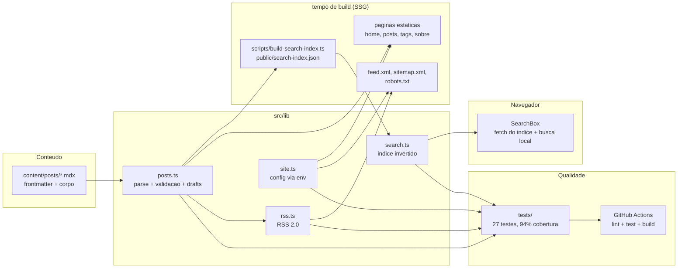

# devlog

[](https://github.com/Vitto-code/devlog/actions/workflows/ci.yml)
[](https://github.com/Vitto-code/devlog)
[](https://github.com/Vitto-code/devlog)

Blog estatico que resolve o problema de publicar conteudo tecnico sem abrir mao de performance, SEO e privacidade: posts em MDX versionados no proprio repositorio, HTML 100% pre-renderizado (SSG), feed RSS e sitemap gerados no build e busca full-text que roda no navegador — sem nenhum servico externo.

## Demonstracao

Capturas reais do build de producao rodando localmente (o tema escuro segue o sistema operacional via `prefers-color-scheme`):

| Pagina inicial | Post | Busca full-text |
| --- | --- | --- |
|  |  |  |

Comportamento: a home lista os posts mais recentes com tempo de leitura; cada post vira um HTML estatico com syntax highlighting, tags e JSON-LD; a busca responde a cada tecla consultando um indice invertido local (consulta "servidor" encontrando o post sobre Server Components acima).

## Arquitetura



## Decisoes tecnicas

- **Next.js App Router com SSG puro em vez de CMS ou SSR.** O conteudo muda por deploy, entao pagar servidor por requisicao seria custo sem beneficio: tudo — inclusive RSS, sitemap e robots — vira arquivo estatico (`force-static`). O trade-off e que publicar exige rebuild; para um blog pessoal, isso e uma feature (revisao via pull request), nao uma limitacao.
- **MDX local com `next-mdx-remote/rsc` em vez de Contentlayer.** O Contentlayer esta sem manutencao ativa; o `next-mdx-remote` renderiza MDX direto em Server Components com dois plugins (`remark-gfm`, `rehype-highlight`). Menos magica, mais controle, uma dependencia viva.
- **Busca full-text propria em vez de Algolia/Pagefind.** Um indice invertido de ~100 linhas ([src/lib/search.ts](src/lib/search.ts)) com normalizacao de acentos e ponderacao (titulo 3x, tags 2x, corpo 1x) cobre a escala de um blog. Vantagens: zero custo, zero JS de terceiros, consultas nunca saem do navegador e a logica e 100% testavel. Limite honesto: acima de alguns milhares de posts o JSON do indice ficaria pesado — ai migraria para Pagefind, que tem o mesmo modelo estatico.
- **Posts como codigo (frontmatter validado).** Frontmatter invalido (sem titulo, data fora de formato) quebra o build com mensagem descritiva, e `draft: true` e filtrado na camada de dados — rascunho nunca vaza para home, RSS, sitemap ou busca. Errar cedo no build, nunca em producao.
- **Vitest na camada de dados em vez de testes de componente.** A logica critica (parse de posts, busca, RSS) e TS puro, entao os testes rodam em milissegundos sem jsdom. Cobertura de 94% sobre `src/lib` com limiar de 70% no CI.

Mais detalhes em [docs/decisions.md](docs/decisions.md) e [docs/architecture.md](docs/architecture.md).

## Como rodar

Pre-requisitos: Node.js 20+. Docker opcional.

```bash
git clone https://github.com/Vitto-code/devlog.git
cd devlog
npm install                 # ou: make setup
npm run dev                 # http://localhost:3000 (indice de busca gerado automaticamente)
```

Build e execucao de producao:

```bash
npm run build               # SSG: paginas, feed.xml, sitemap, search-index.json
npm start                   # serve o build em http://localhost:3000
```

Com Docker:

```bash
docker compose up --build   # http://localhost:3000
```

## Como testar

```bash
npm test                    # testes unitarios
npm run test:coverage       # com cobertura (limiar de 70% em src/lib)
npm run lint                # eslint + verificacao de tipos
```

Verificacao manual do build de producao:

```bash
curl -s http://localhost:3000/feed.xml | head -10        # RSS 2.0 com os posts
curl -s http://localhost:3000/sitemap.xml | head -10     # URLs estaticas
curl -s http://localhost:3000/search-index.json | head -c 200   # indice invertido
curl -s -o /dev/null -w "%{http_code}" http://localhost:3000/posts/ssg-ssr-ou-isr   # 200
```

Para escrever um post, crie `content/posts/AAAA-MM-DD-meu-post.mdx`:

```mdx
---
title: "Meu post"
description: "Resumo em uma frase"
date: "2026-10-16"
tags: ["typescript"]
---

Conteudo em Markdown com componentes: <Callout type="info">Nota.</Callout>
```

## O que aprendi

- **SSG de ponta a ponta**: nao so paginas — feed RSS, sitemap e robots tambem sao estaticos com `force-static` em [src/app/feed.xml/route.ts](src/app/feed.xml/route.ts).
- **Indice invertido na pratica**: normalizacao NFD, tokenizacao e ponderacao por campo em [src/lib/search.ts](src/lib/search.ts), com testes de ranking e AND estrito em [tests/search.test.ts](tests/search.test.ts).
- **Validacao de conteudo como codigo**: frontmatter tipado e erros descritivos em [src/lib/posts.ts](src/lib/posts.ts) — o build falha antes do conteudo quebrado ir ao ar.
- **MDX em Server Components**: renderizacao de MDX com componentes customizados (`Callout`, links externos seguros) em [src/components/mdx-components.tsx](src/components/mdx-components.tsx).
- **SEO programatico**: `generateMetadata`, OpenGraph por post, JSON-LD `BlogPosting` e canonical em [src/app/posts/[slug]/page.tsx](src/app/posts/[slug]/page.tsx).

## Estrutura

```
content/posts/     posts em MDX (fonte do conteudo)
src/
  app/             App Router: home, posts, tags, busca, sobre, feed, sitemap
  components/      PostCard, SearchBox (client), Callout, mdx-components
  lib/             posts, search, rss, site (TS puro, testado)
scripts/           gerador do indice de busca (pre-build)
tests/             posts, search, rss, site (vitest)
docs/              architecture.md, decisions.md, screenshots/
```
