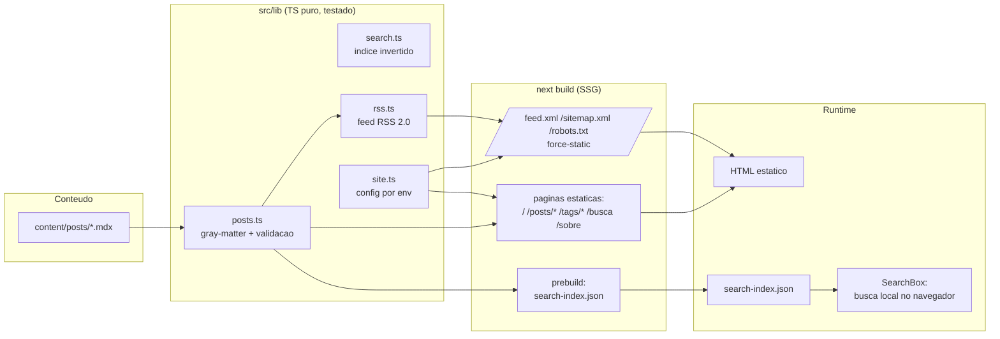
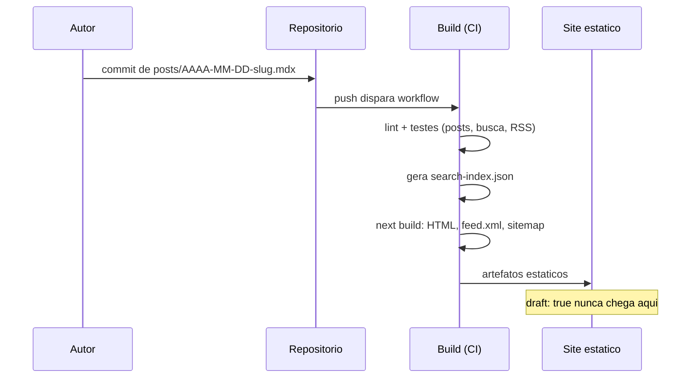

# Arquitetura

## Visao geral

O devlog e um site 100% estatico: todo o trabalho acontece em tempo de build. Em producao, qualquer servidor de arquivos estaticos (ou o `next start` standalone) entrega HTML, XML e JSON prontos.

## Fluxo de publicacao de um post

## Decisoes estruturais

- **Camada de dados isolada em `src/lib/`**: nenhum codigo de pagina acessa `fs` diretamente; paginas consomem `src/lib/content.ts`, que resolve o diretorio de posts. Isso permite testar toda a logica com diretorios-temporarios de fixture.
- **Rascunhos filtrados na fonte**: `getPosts` exclui `draft: true` por padrao, entao home, sitemap, RSS e busca herdam o filtro sem codigo extra — impossivel vazar rascunho por esquecimento.
- **Busca dividida em dois tempos**: indice construido no build (`scripts/build-search-index.ts`), consulta no cliente (`src/lib/search.ts` e isomorfo — o mesmo modulo roda no Node e no navegador e e o alvo dos testes).
- **Erros em tempo de build**: frontmatter invalido lanca excecao descritiva; o `next build` falha e o CI bloqueia o merge.
